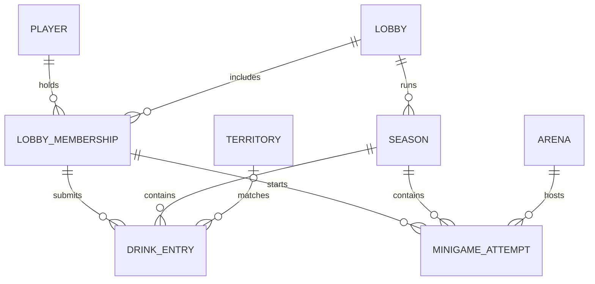

# Entities

> Scoring v1 implementation was authorised on 17 November 2026. See
> [the current contract](SCORING_V1.md) and [Data handoff](../SCORING_IMPLEMENTATION.md).
> Earlier scoring drafts below are historical where they differ. Legacy seasons
> retain their old behaviour; migration and teammate review are pending.

## What an entity is and why it matters

An entity is a thing the game needs to identify and keep track of. Mia is a player. Bairro Alto East is a territory. The photo submission Mia makes on Friday is a drink entry. An **attribute** describes one record, such as the name of a territory. A **relationship** connects records, such as the link from Mia's entry to Bairro Alto East.

This model gives the team a shared answer to questions like “Which player and lobby does this entry belong to?” and “Which boundary did the app match it against?” The photo flow records the answer once. The map, leaderboard, and personal history can then use the same records.

A drink check-in requires a drink type, a size, a fresh photo and a verified location. Exact scoring, eligibility, time windows, ownership, and status transitions belong in `RULES.md` and `LIFECYCLES.md`.

## How the model fits together

| Part of the game | Records |
| --- | --- |
| Who is playing together | `Player`, `Lobby`, `LobbyMembership` |
| Which competition an action belongs to | `Season` |
| Where it happened | `Territory` for drink entries, `Arena` for minigames |
| What happened during play | `DrinkEntry`, `MinigameAttempt` |
| What the player sees | Leaderboard, territory standings, and photo history are views built from those records |

An `id` identifies a record even if its name changes. Fields ending in `_id` link to another record. An optional field can be empty when the information is unavailable or the event has yet to happen. The types below describe the data the app needs. The team can choose database-specific types during implementation.

## Players and competitions

### Player

One record per person who plays WeGoPub. The same player can participate in many lobbies.

| Attribute | Type | Meaning |
| --- | --- | --- |
| `id` | ID | Stable internal player identifier. |
| `display_name` | Text | Unique public username; case-insensitive uniqueness. |
| `first_name`, `last_name` | Text | Required private first name and surname. |
| `email` | Text | Unique private login email, normalized to lowercase. Null only for legacy records awaiting administrator migration. |
| `pin_hash` | Text | Salted password hash. The old column name is retained to preserve existing data; legacy records are retained but have no self-service upgrade screen. |

Photo sharing is an account preference stored separately from `Player` in
`player_photo_preferences`: one `player_id` primary key and a non-null
`share_checkin_photos` boolean, default false. A missing row also means
false. The server validates the current sign-in before reading or saving
one's preference; only the server role can access the table. R6/R-PH01
defines audiences independently of the photo's score or retention.

### Lobby

A group of players who compete together. The draft assumes a private lobby with invitation-based joining.

| Attribute | Type | Meaning |
| --- | --- | --- |
| `id` | ID | Stable lobby identifier. |
| `name` | Text | Name shown to members. |
| `invite_code` | Text | Code used to join the lobby. |
| `game_mode` | Text | `individual` (existing/default) or `team`. |
| `team_count`, `team_capacity` | Integer, optional | Fixed number of teams and maximum members per team. |
| `team_assignment` | Text, optional | `manual` or `random` in team mode. |

### LobbyMembership

Connects one player to one lobby. This is the identity attached to game actions inside that lobby. For example, Mia can submit an entry in her friends' lobby and another in her classmates' lobby using the same player account.

| Attribute | Type | Meaning |
| --- | --- | --- |
| `id` | ID | Identifier for the membership. |
| `player_id` | Player ID | The person who joined. |
| `lobby_id` | Lobby ID | The group they joined. |
| `joined_at` | Timestamp | When they joined. |
| `team_id` | Team ID, optional | Same-lobby team; locked after first accepted score. |

The pair `player_id` and `lobby_id` identifies one membership. A second join request for the same pair should resolve to that membership.

### Team

`lobby_teams` stores `id`, `lobby_id`, `number`, `name`, and optional
`photo_base64` (sanitized JPEG). Each team belongs to one lobby; current
members alone may edit its name and picture. Scores/ownership are replayed
from entries, never stored as editable team totals. R-TEAM01–R-TEAM05 apply.

### Season

The one dated competition in a lobby (R-R03, agreed 18 November 2026). Keeping a Season ID on each action preserves existing scoring/history references. New competitions require a new lobby; existing multi-season history is retained.

| Attribute | Type | Meaning |
| --- | --- | --- |
| `id` | ID | Identifier for this competition. |
| `lobby_id` | Lobby ID | The lobby running the competition under the proposed model. |
| `starts_at` | Timestamp | When the competition begins. |
| `ends_at` | Timestamp | When the competition ends. |

A Season can contain several game nights. The calendar and the rules for actions around midnight belong in `RULES.md`. Each new lobby has one Season and reuses the same Lisbon territories.

## Map and drink entries

### Territory

A named area on the Lisbon map, such as Shortys or Santa Catarina. A polygon is the outline of the area. The map draws that outline and the location check uses it to match a device reading.

| Attribute | Type | Meaning |
| --- | --- | --- |
| `id` | Short text key | Permanent key from `data/territories.geojson`, such as `shortys`, referenced by entries and standings. It never changes, even when the territory is renamed or reshaped. |
| `name` | Text | Label shown on the map and in standings. |
| `boundary` | GeoJSON polygon | Team-defined outline, loaded from the shared territory data. |

`data/territories.geojson` supplies the territory records (R-T01). The location check and the standings both read this file, and the app copies it into the `territories` table on start so drink entries can reference a territory id. Adjacent territories can share a border, and gaps between them are allowed. Their interiors never overlap, so a point inside one area has a single match (R-T02). The standings identify the holder for a given competition. One territory can therefore have different holders in different lobbies.

### DrinkEntry

One drink submission by a signed-in lobby member in a Season. The player selects a drink and its size and takes a fresh photo in Check-in. The server records the location result and assigns a territory when it finds a match. Raw coordinates from the device and photo are used only during verification.

A fresh phone reading taken at submission is the player's location (R-L01). GPS tags in the photo are not used.

| Attribute | Type | Meaning |
| --- | --- | --- |
| `id` | ID | Identifier used by the submission detail and photo history. |
| `membership_id` | LobbyMembership ID | The member who submitted the entry. |
| `team_id` | Team ID, optional | Immutable team snapshot; null in individual mode. |
| `owner_team_id` | Team ID, optional | Prior owner receiving team income; individual entries retain `owner_membership_id`. |
| `season_id` | Season ID | Competition to which the submission belongs. |
| `submitted_at` | Timestamp | Server-recorded submission time. |
| `photo_ref` | File reference | Private storage path, or `deleted` / `expired` after removal under R7. Current members of the entry's lobby can view unexpired photos only when R6/R-PH01 sharing permits. Photo removal preserves the scored entry. |
| `photo_captured_at` | Timestamp, optional | When Check-in received the camera photo. Older entries may only have a submission time. |
| `territory_id` | Territory ID, optional | Territory assigned to this entry. Empty while a match is unknown or when the entry has no assigned territory. |
| `location_check_result` | Status | Outcome of the device check. Examples include `matched`, `uncertain`, `outside`, and `unavailable`. |
| `location_checked_at` | Timestamp, optional | When the server evaluated the location reading, if one was available. |

The submitter's membership and the Season belong to the same lobby. If the location is unavailable or uncertain, the player can retry from the same form. A saved entry with a verified location outside every territory has an empty `territory_id` and can earn Season points.

## Minigames

### ChugDuel

Implemented on 18 November 2026, separately from the legacy MinigameAttempt
placeholder below. One challenge links `season_id`, `challenger_id` and
`opponent_id` (membership IDs), agreed `drink_type`/`size` and a `game_night`
date using a 06:00 cutoff in the season timezone. State is invited, accepted,
started, completed, aborted, declined, cancelled or expired. Server timestamps
track creation, acceptance, start, countdown (`play_at`), finish and expiry.
`winner_id` is a participating membership. Two preallocated entry IDs identify
the normal drink entries created atomically on start.

The linked DrinkEntries carry `duel_id`. Only the losing entry after completion
carries `duel_transfer_to` (saved winner competitor: team or membership) and
`duel_transfer_order` (result position in the shared scoring sequence). These
fields change season replay without changing original territory base awards
or owner income. Both entries keep their own private image copy and frozen
team identity. See RULES.md R-M01–R-M05 and [the handoff](../CHUG_DUEL.md).

Normal-season outgoing/incoming allowances are unique by membership and
game-night date, so they are per lobby and cannot be bypassed by selecting a
different opponent. Migration 012 adds a server-derived `test_mode` flag,
copied from the frozen season's boolean QA setting on every insert/update.
QA rows are exempt from the nightly unique indexes; a caller cannot opt a
normal duel into this exception. Active/pending game restrictions still apply
and finished attempts remain saved for history. Other proposed games/items
remain unimplemented.

### Arena

A named location on the Lisbon map where the team plans to offer minigames.

| Attribute | Type | Meaning |
| --- | --- | --- |
| `id` | ID | Identifier referenced by attempts. |
| `name` | Text | Label shown to players. |
| `map_point` | GeoJSON point | Public position of the arena marker. |

### MinigameAttempt

One start by a player, with an eventual outcome if the game finishes. Keeping the attempt as a record lets the server apply a shared limit when the player tries a different game or arena.

| Attribute | Type | Meaning |
| --- | --- | --- |
| `id` | ID | Identifier for the attempt. |
| `membership_id` | LobbyMembership ID | The member who started it. |
| `season_id` | Season ID | Competition in which the attempt took place. |
| `arena_id` | Arena ID | Arena where it started. |
| `game_type` | Game identifier | Which minigame the player chose. |
| `game_night` | Game night identifier | Play window that contains the attempt. |
| `started_at` | Timestamp | When the server recorded the start. |
| `status` | Status | State of the attempt, such as started or completed. |
| `result` | Game result, optional | Outcome after completion. The minigame defines its contents. |

The proposed shared limit uses the underlying player's ID and the game-night identifier. Game and arena identify the attempt but do not give the player a fresh allowance. The team still needs to confirm how interruptions are treated and whether the same allowance follows a player across lobbies.

## Entity relationship diagram

The diagram shows how many records can sit on either side of a link. For example, one territory can match many entries. One entry can match zero or one territory.

## A drink submission from photo to standings

1. Mia uploads a photo during her lobby's current Season. A `DrinkEntry` stores her membership, the Season, and the photo reference.
2. Mia grants location permission. The phone reading matches Bairro Alto East, so the entry records that territory's ID and a `matched` result.
3. The leaderboard uses the entry if it qualifies under `RULES.md`. The map can use the same territory ID for the territory standings. If the team chooses separate claims, the map also reads the claims placed there. Mia's photo history uses the entry and its photo reference.

If the phone's accuracy overlaps two territory boundaries, the entry can keep an `uncertain` location result while the territory ID is empty. The team can decide whether to offer a location retry.

## What the app calculates from records

| View | Source |
| --- | --- |
| Season leaderboard | Qualifying records for one Season, grouped by player. `RULES.md` defines which records score and how ties are handled. |
| Territory standings and map color | Qualifying territory-linked entries or separate claims, depending on the team decision. Calculate these in the relevant competition so one lobby's lead does not affect another's. |
| Photo history | The player's drink entries ordered by time, with photo references and location check results. |

## Decisions that change the model

| Open decision | What changes in this model |
| --- | --- |
| Is each Season owned by one lobby or shared across all lobbies? | Keep `Season.lobby_id` for lobby-specific Seasons. With shared Seasons, scope gameplay and standings by both Season and lobby membership. |
| Do drink entries determine territory control directly, or do players place separate claims? | Direct control uses `DrinkEntry.territory_id`. A separate claim needs its own record because the player can choose which territory to target. |
| Can an entry without a matched territory earn Season points? | The existing model can store the photo with an empty `territory_id`. The scoring rule determines whether it qualifies. |
| Can players select an existing photo or must they capture it during submission? | The phone reading records location at submission. If the team accepts both paths and treats them differently, add a `photo_source` field for in-app capture versus gallery upload. |
| Do photos have their own sharing, deletion, or gallery rules? | The current entry holds a file reference. Give photos a separate entity if they need an independent lifecycle or access setting. |
| Is the nightly minigame limit shared across lobbies? | Use player plus night for a global limit. Add lobby scope if each lobby runs its own allowance. |

## Later additions

These are candidates from the ideas list. Bring them into the diagram once the team chooses the features and their rules.

| Candidate | What the record would add | Likely links |
| --- | --- | --- |
| `TerritoryClaim` | An explicit decision to contest a territory during a game night. | Membership, Season, territory, game night, time placed. |
| `RewardItem` | An item won in a minigame and available to use later. | Owning membership, source attempt, item type, time awarded, time used. |
| `TerritoryEffect` | An active effect on a territory, such as the proposed 24-hour shield. | Source item, territory, Season, start and expiry times. |
| `VacationDay` | A date a player marks as away. | Player and date, with lobby or Season scope to be decided. |

The rule for a shield takeover, the effect of Vacation Mode, and the timing of claims belong in `RULES.md`. Record unresolved choices in `OPEN_DECISIONS.md` when the team reviews the model.

## Scoring planning record and shared-model review

See [P-S05/P-S06](SCORING_PROPOSAL.md#p-s05) for separate season/territory totals and owner-income recipients, [P-S12](SCORING_PROPOSAL.md#p-s12) for revision/audit/replay needs and [P-S13](SCORING_PROPOSAL.md#p-s13) for frozen season settings and lobby timezone. The implementation below records the resulting fields; teammate review and shared database migration remain pending.

## Scoring v1 data additions

These fields are implemented in the local models and prepared in
`migrations/005_scoring_v1.sql`; they are not a claim that the shared database
has already been migrated.

| Record | Fields / meaning |
| --- | --- |
| Season | `timezone_name`, `scoring_version`, `scoring_rules`: complete frozen timezone/rule snapshot; existing rows are legacy. |
| DrinkEntry | `size`, `rule_version`, `event_order`: explicit size and authoritative accepted order. `amount` is defined ml for v1 beer/wine, legacy units on historical rows. |
| DrinkEntry | `owner_membership_id`, `owner_bonus_quarters`: additional recipient and exact quarter-point income from this source entry. |
| DrinkEntry | `revision`, `corrected_at`: optimistic correction version and latest correction time. |
| drink_entry_revisions | Author, source entry, old/new drink/size, revision and time; server-only audit. |

Season leaderboard and territory standings derive from the same corrected source
history. An owner's extra award belongs only to that lobby/season. Photo removal
preserves all scoring fields. See [the implemented rules](SCORING_V1.md).

## Friendship

A relationship between two existing Players, independent of Lobbies.
One row per unordered player pair stores `sender_id`, `recipient_id`,
`status` (`pending`, `accepted`, `declined`, `cancelled`, `removed`),
`updated_at` and a changing `version` for concurrent updates. Canonical
`pair_low` / `pair_high` keys prevent reverse-direction duplicates.
No fields on Player change. Declined rows retain their timestamp so the
10-minute wait survives restarts. Only each participant's own Profile
reads their relationships; public search selects just player ID and username.

## FocusAttempt and boosted entries (19 November 2026)

`focus_attempts` is separate from the legacy `MinigameAttempt` and Chug Duel.
It links membership, season and 06:00-based night; stores attempt number,
private random challenge, status/phase/step/revision, reaction results,
precision checkpoints and authoritative start/signal/deadline/expiry times.
A passed row stores completion and boost expiry. Partial unique indexes allow
one running attempt per member/season and one normal-season win per night.
Migration 015 adds a server-derived `test_mode` boolean to each attempt; QA wins
are excluded from the one-win index. Sequential attempt numbers remain unique,
and callers cannot select QA mode independently of the frozen season flag. Public clients
cannot read the table or call its RPCs. No health label, photo or GPS is stored.

`DrinkEntry.focus_attempt_id` is immutable reward provenance on ordinary entries.
`points_awarded` is the actual accepted award including that effect. SQL numeric
half-points and half-quarter owner-income units preserve exact eighth-points;
whole values remain integers in Python presentation. Timely corrections retain
the source multiplier; historical replay does not need today's boost status.

### Lobby departure extension (19 November 2026)

`LobbyMembership.left_at` is a nullable server departure timestamp. Null grants
current membership; a value retains historical identity without lobby access.
Rejoining clears it and keeps the original ID, joining time and team. Active
access reads exclude departed rows; profile history, standings names and team
capacity explicitly include them. See R-LB01–R-LB03.

`DrinkEntry.absent_member_ids` is an immutable roster snapshot at acceptance.
It suppresses personal owner income for absent owners during replay and later
corrections, without changing historical points or team income. Migration 016
adds both fields and the leave/rejoin server functions.
