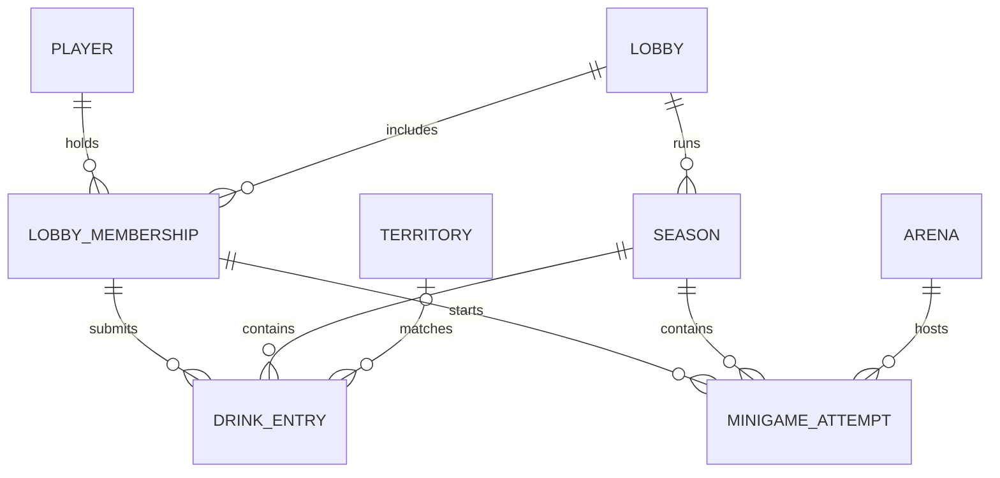

# Entities

## What an entity is and why it matters

An entity is a thing the game needs to identify and keep track of. Mia is a player. Bairro Alto East is a territory. The photo submission Mia makes on Friday is a drink entry. An **attribute** describes one record, such as the name of a territory. A **relationship** connects records, such as the link from Mia's entry to Bairro Alto East.

This model gives the team a shared answer to questions like “Which player and lobby does this entry belong to?” and “Which boundary did the app match it against?” The photo flow records the answer once. The map, leaderboard, and personal history can then use the same records.

This draft uses a photo upload as the only required input and can match an entry directly to a territory polygon. Exact scoring, eligibility, time windows, ownership, and status transitions belong in `RULES.md` and `LIFECYCLES.md`.

## How the model fits together

| Part of the game | Records |
| --- | --- |
| Who is playing together | `Player`, `Lobby`, `LobbyMembership` |
| Which competition an action belongs to | `Season` |
| Where it happened | `Territory` for drink entries, `Arena` for minigames |
| What happened during play | `DrinkEntry`, `MinigameAttempt` |
| What the player sees | Leaderboard, territory standings, and photo history are views built from those records |

An `id` identifies a record even if its name changes. Fields ending in `_id` link to another record. An optional field can be empty when the information is unavailable or the event has yet to happen. The types below describe the data the app needs. The team can choose database-specific types during implementation.

## Players and competitions

### Player

One record per person who plays WeGoPub. The same player can participate in many lobbies.

| Attribute | Type | Meaning |
| --- | --- | --- |
| `id` | ID | Stable internal player identifier. |
| `display_name` | Text | Name shown on the profile and rankings. |

### Lobby

A group of players who compete together. The draft assumes a private lobby with invitation-based joining.

| Attribute | Type | Meaning |
| --- | --- | --- |
| `id` | ID | Stable lobby identifier. |
| `name` | Text | Name shown to members. |
| `invite_code` | Text | Code used to join the lobby in the proposed flow. |

### LobbyMembership

Connects one player to one lobby. This is the identity attached to game actions inside that lobby. For example, Mia can submit an entry in her friends' lobby and another in her classmates' lobby using the same player account.

| Attribute | Type | Meaning |
| --- | --- | --- |
| `id` | ID | Identifier for the membership. |
| `player_id` | Player ID | The person who joined. |
| `lobby_id` | Lobby ID | The group they joined. |
| `joined_at` | Timestamp | When they joined. |

The pair `player_id` and `lobby_id` identifies one membership. A second join request for the same pair should resolve to that membership.

### Season

A dated competition in a lobby. Keeping a Season ID on each action lets the app show a new competition alongside results from an earlier one.

| Attribute | Type | Meaning |
| --- | --- | --- |
| `id` | ID | Identifier for this competition. |
| `lobby_id` | Lobby ID | The lobby running the competition under the proposed model. |
| `starts_at` | Timestamp | When the competition begins. |
| `ends_at` | Timestamp | When the competition ends. |

A Season can contain several game nights. The calendar and the rules for actions around midnight belong in `RULES.md`. The working assumption is that each lobby has its own Seasons and can reuse the same Lisbon territories.

## Map and drink entries

### Territory

A named area on the Lisbon map, such as Bairro Alto East or Pink Street. A polygon is the outline of the area. The map draws that outline and the location check uses it to match a device reading.

| Attribute | Type | Meaning |
| --- | --- | --- |
| `id` | ID | Stable territory identifier referenced by entries and standings. |
| `name` | Text | Label shown on the map and in standings. |
| `boundary` | GeoJSON polygon | Team-defined outline, loaded from the shared territory data. |

For the prototype, `territories.geojson` can supply the territory records. The map and server should read the same definitions. Adjacent territories can share a border. Their interiors should be distinct so a point inside one area has a single match. The standings identify the holder for a given competition. One territory can therefore have different holders in different lobbies.

### DrinkEntry

One drink submission by a signed-in lobby member in a Season. The uploaded photo is the only required player input. WeGoPub can request a fresh phone location with permission at submission and attach the reading if available. The server records the result, assigns a territory when it finds a match, and discards the raw coordinates and reported accuracy after the check.

A fresh phone reading supports the player's location at submission time. For a photo selected from the gallery, the original capture location may be different. Taking the photo inside the app during the same submission gives a closer link between the photo and the location reading. GPS tags in the photo's metadata can serve as a clue and may be missing or changed.

| Attribute | Type | Meaning |
| --- | --- | --- |
| `id` | ID | Identifier used by the submission detail and photo history. |
| `membership_id` | LobbyMembership ID | The member who submitted the entry. |
| `season_id` | Season ID | Competition to which the submission belongs. |
| `submitted_at` | Timestamp | Server-recorded submission time. |
| `photo_ref` | File reference | Required reference to the uploaded photo. |
| `territory_id` | Territory ID, optional | Territory assigned to this entry. Empty while a match is unknown or when the entry has no assigned territory. |
| `location_check_result` | Status | Outcome of the device check. Examples include `matched`, `uncertain`, `outside`, and `unavailable`. |
| `location_checked_at` | Timestamp, optional | When the server evaluated the location reading, if one was available. |

The submitter's membership and the Season belong to the same lobby. If location permission is denied or a reading is unavailable, the entry can still store the photo with an `unavailable` result and an empty `territory_id`. `RULES.md` determines whether entries without a territory can score in the Season. If the team chooses drink categories for scoring or collections, add a `drink_type` field, or a `DrinkType` entity if categories need their own configuration.

## Minigames

### Arena

A named location on the Lisbon map where the team plans to offer minigames.

| Attribute | Type | Meaning |
| --- | --- | --- |
| `id` | ID | Identifier referenced by attempts. |
| `name` | Text | Label shown to players. |
| `map_point` | GeoJSON point | Public position of the arena marker. |

### MinigameAttempt

One start by a player, with an eventual outcome if the game finishes. Keeping the attempt as a record lets the server apply a shared limit when the player tries a different game or arena.

| Attribute | Type | Meaning |
| --- | --- | --- |
| `id` | ID | Identifier for the attempt. |
| `membership_id` | LobbyMembership ID | The member who started it. |
| `season_id` | Season ID | Competition in which the attempt took place. |
| `arena_id` | Arena ID | Arena where it started. |
| `game_type` | Game identifier | Which minigame the player chose. |
| `game_night` | Game night identifier | Play window that contains the attempt. |
| `started_at` | Timestamp | When the server recorded the start. |
| `status` | Status | State of the attempt, such as started or completed. |
| `result` | Game result, optional | Outcome after completion. The minigame defines its contents. |

The proposed shared limit uses the underlying player's ID and the game-night identifier. Game and arena identify the attempt but do not give the player a fresh allowance. The team still needs to confirm how interruptions are treated and whether the same allowance follows a player across lobbies.

## Entity relationship diagram

The diagram shows how many records can sit on either side of a link. For example, one territory can match many entries. One entry can match zero or one territory.

## A drink submission from photo to standings

1. Mia uploads a photo during her lobby's current Season. A `DrinkEntry` stores her membership, the Season, and the photo reference.
2. Mia grants location permission. The phone reading matches Bairro Alto East, so the entry records that territory's ID and a `matched` result.
3. The leaderboard uses the entry if it qualifies under `RULES.md`. The map can use the same territory ID for the territory standings. If the team chooses separate claims, the map also reads the claims placed there. Mia's photo history uses the entry and its photo reference.

If the phone's accuracy overlaps two territory boundaries, the entry can keep an `uncertain` location result while the territory ID is empty. The team can decide whether to offer a location retry.

## What the app calculates from records

| View | Source |
| --- | --- |
| Season leaderboard | Qualifying records for one Season, grouped by player. `RULES.md` defines which records score and how ties are handled. |
| Territory standings and map color | Qualifying territory-linked entries or separate claims, depending on the team decision. Calculate these in the relevant competition so one lobby's lead does not affect another's. |
| Photo history | The player's drink entries ordered by time, with photo references and location check results. |

## Decisions that change the model

| Open decision | What changes in this model |
| --- | --- |
| Is each Season owned by one lobby or shared across all lobbies? | Keep `Season.lobby_id` for lobby-specific Seasons. With shared Seasons, scope gameplay and standings by both Season and lobby membership. |
| Do drink entries determine territory control directly, or do players place separate claims? | Direct control uses `DrinkEntry.territory_id`. A separate claim needs its own record because the player can choose which territory to target. |
| Can an entry without a matched territory earn Season points? | The existing model can store the photo with an empty `territory_id`. The scoring rule determines whether it qualifies. |
| Can players select an existing photo or must they capture it during submission? | The phone reading records location at submission. If the team accepts both paths and treats them differently, add a `photo_source` field for in-app capture versus gallery upload. |
| Do photos have their own sharing, deletion, or gallery rules? | The current entry holds a file reference. Give photos a separate entity if they need an independent lifecycle or access setting. |
| Is the nightly minigame limit shared across lobbies? | Use player plus night for a global limit. Add lobby scope if each lobby runs its own allowance. |

## Later additions

These are candidates from the ideas list. Bring them into the diagram once the team chooses the features and their rules.

| Candidate | What the record would add | Likely links |
| --- | --- | --- |
| `TerritoryClaim` | An explicit decision to contest a territory during a game night. | Membership, Season, territory, game night, time placed. |
| `RewardItem` | An item won in a minigame and available to use later. | Owning membership, source attempt, item type, time awarded, time used. |
| `TerritoryEffect` | An active effect on a territory, such as the proposed 24-hour shield. | Source item, territory, Season, start and expiry times. |
| `VacationDay` | A date a player marks as away. | Player and date, with lobby or Season scope to be decided. |

The rule for a shield takeover, the effect of Vacation Mode, and the timing of claims belong in `RULES.md`. Record unresolved choices in `OPEN_DECISIONS.md` when the team reviews the model.
